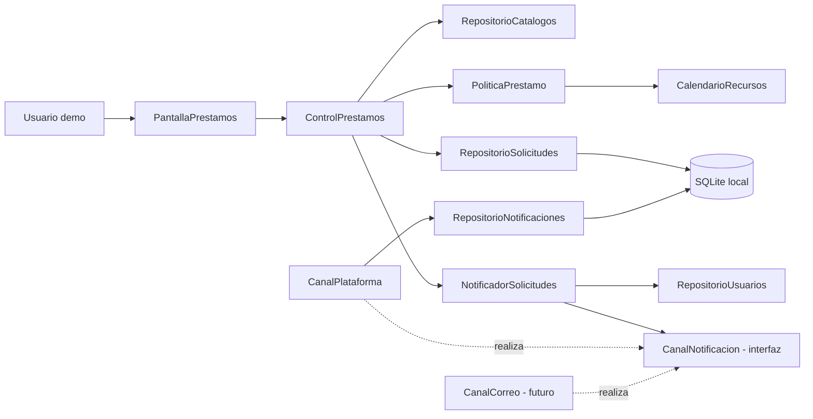

# RFC Técnico — RFC-SPEC-01: Solicitud de préstamo de equipamiento
## Prototipo del CU_01 · Laboratorio de Medios Audiovisuales (UNTDF)

| Campo | Detalle |
| :--- | :--- |
| **Título** | RFC-SPEC-01: Solicitud de préstamo de equipamiento |
| **Proyecto** | Sistema de Gestión de Servicios del Laboratorio de Medios Audiovisuales |
| **Materia / Grupo** | Ingeniería de Software I — Grupo 6 |
| **Integrantes** | Agustín Arias, Mateo Mazuela, Milagros Martínez, Luca Mechulan |
| **Fecha** | Noviembre 2026 |
| **Estado** | **APROBADO PARA BUILD DEL PROTOTIPO CU_01 — decisiones de alcance y reglas cerradas por el solicitante (17/11/2026); revisión académica UML y Validate pendientes.** |
| **Revisores** | Revisión interna: Grupo 6. Validación académica pendiente de la cátedra; no se atribuye aprobación al docente. |
| **Fuente de verdad** | Spec 1 y CU_01 de la tercera entrega reconstruida; RF, RNF, correcciones docentes |

> **Alcance de este RFC:** prototipo del **CU_01 (crítico)** dentro de la Spec 1, no implementación completa de la Spec 1. La Spec 1 abarca también CU_02, CU_03 y CU_04, pero la consigna de cuarta entrega requiere prototipar el caso crítico. Se conserva la referencia a los otros casos sin fingir que están implementados. El recorte CU_01 fue confirmado por el solicitante el 17/11/2026. Este documento no supone aprobación académica del modelo UML.

### Registro de aprobación de decisiones (17/11/2026)

**Estado documental: APROBADO PARA BUILD DEL PROTOTIPO CU_01 POR EL SOLICITANTE.** La aprobación se limita a alcance, reglas de demostración y herramienta, según las decisiones expresas comunicadas el 17/11/2026; **no equivale a aprobación del profesor ni de todos los integrantes**. El documento se entrega con una auditoría UML separada: la presentación académica de los diagramas se mantiene pendiente de subsanación y revisión. La política de alta gama es un supuesto controlado del prototipo, no una regla de Natalia validada empíricamente.

## 1. Alcance del prototipo y enfoque

El prototipo permite que un estudiante o docente ya identificado registre una solicitud de equipamiento de una categoría y cantidad, indicando período y materia/proyecto asociado. Valida datos, disponibilidad, restricciones y elegibilidad académica; presenta un resumen; registra la solicitud en **Pendiente/Solicitada**; conserva el evento inicial de trazabilidad y permite visualizarla en un listado. Si el solicitante es académicamente elegible pero el pedido requiere aval docente, la solicitud puede quedar pendiente de esa validación y se genera un aviso interno. **Solicitar no equivale a aprobar ni a reservar unidades concretas.** Regla aprobada únicamente para la demostración: la elegibilidad bloquea el registro si no se cumple; un estudiante elegible puede registrar la solicitud pendiente y el aval se resuelve posteriormente en CU_03. No se definieron umbrales académicos universales.

| Componente / comportamiento | Estado | Nota |
| :--- | :--- | :--- |
| Formulario web de CU_01 | **Real** | Tipo, cantidad, fechas, materia/proyecto, botones y feedback |
| Validación de datos y período | **Real** | Fechas consistentes, campos requeridos, cantidad positiva |
| Consulta de disponibilidad por categoría | **Real** | Unidades operativas menos ocupaciones aprobadas o activas; revalidar al confirmar |
| Restricciones activas y elegibilidad académica de alta gama | **Real** | Se alimenta de datos de ejemplo; la falta de elegibilidad académica bloquea la solicitud |
| Creación de SolicitudPrestamo pendiente | **Real** | Número, fecha/hora, usuario y estado; no crear Prestamo efectivo |
| Persistencia local / auditoría inicial | **Real** | SQLite local con datos de demostración |
| Notificación dentro de la plataforma | **Real**, acotada | Registrar aviso para destinatarios de validación; envío de correo fuera del prototipo |
| Identidad de usuario / acceso | **Simulado** | Sesión de demostración con usuario de ejemplo ya autenticado; **no cumple RNF-01/RNF-02 como autenticación real** |
| Aval docente posterior | **Fuera de alcance para la resolución** | CU_01 registra la necesidad de aval y notifica; CU_03 resuelve la validación. Regla cerrada para la demo; la política de producción sigue sujeta a validación con la cátedra/cliente. |
| Prórroga, evaluación, entrega y devolución | **Fuera de alcance** | CU_02, CU_03, CU_05 y CU_06 |
| Reserva conjunta de aula y equipamiento | **Fuera de alcance** | CU_09; requiere integración posterior |
| Correo electrónico real | **Fuera de alcance** | RNF-21 admite notificación en plataforma según configuración |

### 1.1 Alternativas evaluadas

| Criterio | A. Python + FastAPI + SQLite + JS nativo | B. TypeScript + Express + SQLite + React |
| :--- | :--- | :--- |
| Cobertura CU_01 | Completa, con pocas dependencias | Completa |
| Complejidad de prototipo | Baja-media: un proyecto y HTML/JS | Media-alta: frontend y backend separados |
| Pruebas | pytest y cliente HTTP | Vitest y supertest |
| Persistencia | SQLAlchemy + SQLite | ORM/driver SQLite |
| Riesgo de plazo | Menor | Mayor por configuración y tooling |
| Evolución posterior | API HTTP reutilizable | Conveniente si el equipo ya maneja TS/React |

**Decisión aprobada para la demostración (17/11/2026):** alternativa A (Python + FastAPI + SQLite + JavaScript nativo). El profesor aclaró en clase que puede utilizarse el asistente de IA que elija el grupo; se utilizará Codex en VS Code. Gemini es la opción sugerida y gratuita, no una obligación excluyente. Se respetará AGENTS.md y el proceso SDD.

## 2. Stack tecnológico propuesto

| Capa | Tecnología | Versión propuesta | Justificación |
| :--- | :--- | :--- | :--- |
| Lenguaje y runtime | Python | 3.13.18 (referencia; fijar la versión real del entorno en Build) | Rama válida para el prototipo; no declarar disponibilidad local hasta verificarla en el equipo de demo |
| Frontend | HTML5, CSS3, JavaScript | Estándares del navegador | Reducir dependencias para CU_01 |
| Backend web / API | FastAPI | 0.163.1 | Tipado de entrada, validación y API local |
| Servidor ASGI | Uvicorn | 0.54.0 | Servidor local del prototipo |
| Persistencia | SQLite + SQLAlchemy | SQLite integrada; SQLAlchemy 2.1.9 | Datos reales locales con auditoría |
| Pruebas | pytest + httpx | pytest 9.2.0; httpx 0.28.1 | Unitarias y flujos HTTP |
| Editor | VS Code | Versión instalada verificada en Build | Requisito de cátedra |
| Asistente de IA | Codex en VS Code (elección del grupo; Gemini como alternativa) | Decisión confirmada para la demo; registrar versión/extensión real en Build | El profesor permitió utilizar cualquier asistente de IA, según aclaración informada por el estudiante |
| Control de versiones | Git | Versión disponible | Revisión de tareas y commits trazables |

**Nota de reproducibilidad:** estas versiones se seleccionan a partir de publicaciones oficiales revisadas nuevamente el 17/11/2026. **Todavía no se instaló ni probó la compatibilidad del conjunto**. En Build se fijarán versiones compatibles en el archivo de dependencias y se documentará el entorno real, sin declarar una instalación no ejecutada.

### 2.1 Requisitos del entorno

- Linux (Fedora) o Windows con Python 3.13, Git, VS Code y navegador actualizado.
- Sin claves de API externas para ejecutar el prototipo funcional.
- Base SQLite de desarrollo con usuarios, materias, restricciones, equipos y asignaciones ficticias.
- La base de datos de demostración se recrea desde un script de inicialización controlado.

## 3. Arquitectura



### 3.1 Componentes y responsabilidades

| Componente | Responsabilidad | Depende de |
| :--- | :--- | :--- |
| PantallaPrestamos | Mostrar formulario, resumen, errores y confirmación; no aplicar reglas | ControlPrestamos |
| ControlPrestamos | Coordinar CU_01, consultar catálogo, prevalidar y confirmar sin mezclar persistencia | PoliticaPrestamo, RepositorioCatalogos, RepositorioSolicitudes, NotificadorSolicitudes |
| PoliticaPrestamo | Validar formato, disponibilidad, restricciones, alta gama y necesidad de aval; revalidar al confirmar | CalendarioRecursos; Estudiante, TipoEquipamiento y MateriaProyecto como parámetros |
| CalendarioRecursos | Informar cantidad libre por tipo y período | Equipamiento y ocupaciones vigentes |
| SolicitudPrestamo / Solicitud | Representar la petición pendiente y su ciclo de estado | Usuario y MateriaProyecto |
| RepositorioSolicitudes | Guardar Solicitud + CambioEstado en una transacción y listar solicitudes | Contrato abstracto; implementado por RepositorioSQLite |
| RepositorioSQLite | Implementación concreta del contrato de persistencia | Realiza RepositorioSolicitudes; SQLite |
| NotificadorSolicitudes | Consultar destinatarios, crear avisos y delegar enviar(aviso) en CanalNotificacion | RepositorioUsuarios y CanalNotificacion (interfaz) |
| CanalPlataforma | Implementación del canal interno; persiste cada aviso | Realiza CanalNotificacion; RepositorioNotificaciones |

### 3.2 Alineación con modelo de clases del TPI

| Clase del TPI | En la propuesta técnica | Modificación justificada |
| :--- | :--- | :--- |
| Usuario, Estudiante, Docente | Entidades del dominio | Elegibilidad académica y restricciones en Estudiante; Docente conserva sus permisos propios |
| Docente, AsignacionDocenteMateria y MateriaProyecto | Entidades enlazadas por una clase de asociación interpuesta | Docente 1 — 0..* AsignacionDocenteMateria; cada asignación corresponde a una MateriaProyecto. Permite consultar avales sin asociación M:N directa. |
| Solicitud, SolicitudPrestamo | Entidades del dominio | Estado tipado; constructor invocado por ControlPrestamos y evento inicial creado por AuditorSolicitudes |
| Equipamiento, CalendarioRecursos | Entidades / servicio de dominio | TipoEquipamiento indica alta gama; CalendarioRecursos calcula disponibilidad sin listar préstamos de usuarios |
| Restriccion, MateriaProyecto, Notificacion, CambioEstado | Dominio | Tipo y firmas; CambioEstado se registra en Solicitud y se guarda en la misma transacción |
| PantallaPrestamos, ControlPrestamos | Frontera y controlador | Formalización de operaciones, parámetros y visibilidad |
| PoliticaPrestamo, NotificadorSolicitudes | Nuevas clases técnicas | GRASP Fabricación pura, Indirección, Bajo acoplamiento |
| RepositorioSolicitudes y RepositorioSQLite | Nuevas clases técnicas | Indirección y Variaciones Protegidas: ControlPrestamos depende de la interfaz; RepositorioSQLite la realiza |
| RepositorioCatalogos | Consultar tipos y materias por identificador | ControlPrestamos recibe tipo y materia reales antes de validar |
| RepositorioUsuarios / RepositorioPrestamos | Consultar cuentas y préstamos, respectivamente | Unicidad y préstamos personales no son responsabilidades de CalendarioRecursos |
| RepositorioNotificaciones | Guardar avisos internos de validación | CanalPlataforma lo utiliza; el notificador solo conoce CanalNotificacion |
| DetallePrestamo y AfectacionEmergenciaReserva | Clases interpuestas fuera de CU_01 | Representan asignación de unidad y afectación de reserva, sin expandir el prototipo |

La clase interpuesta AsignacionDocenteMateria permite identificar qué docentes están asignados a cada materia; RepositorioUsuarios incluye además validadores del laboratorio autorizados según rol.

El **diagrama único de clases de diseño v9.3** se muestra una sola vez (Figura 2 de la sección 7 del TPI). Incorpora además `PantallaProrrogas`, `ControlProrrogas`, `PantallaRegistro` y `ControlRegistro`, porque aparecen en los diagramas dinámicos acumulados. El CU_01 usa las firmas declaradas en `ControlPrestamos`, `PoliticaPrestamo`, `RepositorioSolicitudes` y `NotificadorSolicitudes`. La matriz CSV adjunta vincula cada mensaje con su firma y relación. El RFC mantiene su alcance de prototipo únicamente para CU_01.


**Ajuste GRASP v9 — responsabilidades, polimorfismo y relaciones M:N:** las entidades de datos (Estudiante, Prestamo, TipoEquipamiento, Solicitud y Restriccion) exponen atributos mediante constructores y accesores; la evaluación de reglas se encuentra en PoliticaPrestamo / ControlProrrogas. `AuditorSolicitudes.registrarAlta(solicitud, usuario)` construye `CambioEstado` y la solicitud lo agrega a su historial. Una clase interpuesta `AsignacionDocenteMateria` materializa la relación académica M:N. `CanalNotificacion.enviar(aviso)` define una operación polimórfica; `CanalPlataforma` la implementa con `RepositorioNotificaciones`, y `CanalCorreo` queda solamente como alternativa futura. En el prototipo se usa exclusivamente plataforma. La creación de solicitudes se asigna a los controladores que reúnen los datos de inicialización (**Creador**). Se agregan DetallePrestamo y AfectacionEmergenciaReserva para representar relaciones M:N con datos propios. Las operaciones de incorporación de equipamiento y registro de tutorías a demanda salen de las entidades y pasan a ControlReservas y ControlTutorias; quedan fuera del prototipo CU_01.

## 4. Diseño detallado

### 4.1 Flujo principal (CU_01)

1. Usuario de demostración inicia CU_01 y se presenta el formulario con controles concretos.
2. Ingresa tipo, cantidad, fecha desde/hasta y materia/proyecto; pulsa **Continuar**.
3. `ControlPrestamos` obtiene `TipoEquipamiento` y `MateriaProyecto` de `RepositorioCatalogos` mediante sus identificadores y los pasa, junto con el usuario y los datos, a `PoliticaPrestamo`. Se validan formato, disponibilidad, restricciones y elegibilidad académica/necesidad de aval. El **fork/join** es una característica del modelo de actividades; para el prototipo se tratarán como tres validaciones independientes con resultados sincronizados; la orquestación será verificable en pruebas.
4. Si todas son satisfactorias, la interfaz muestra resumen y botones **Confirmar, Volver y Cancelar**.
5. Al confirmar, se vuelven a consultar los catálogos y se **revalidan** disponibilidad, restricciones y elegibilidad antes de cualquier guardado; un cambio desfavorable no produce una solicitud.
6. `ControlPrestamos` crea una `SolicitudPrestamo` e invoca `AuditorSolicitudes.registrarAlta(solicitud, usuario)`. Esa operación genera `CambioEstado` con fecha/hora y actor, y `RepositorioSolicitudes.guardarConHistorial` persiste ambos en una transacción.
7. Si el solicitante es elegible y requiere aval docente, `NotificadorSolicitudes` consulta `RepositorioUsuarios.destinatariosAval(materia)` para localizar docentes asignados a la materia y personal del laboratorio autorizado, crea avisos internos y los envía mediante `CanalNotificacion.enviar(aviso)`; en el prototipo, `CanalPlataforma` los conserva a través de `RepositorioNotificaciones`, para posterior validación en CU_03. No se envía correo real.
8. El sistema muestra número y estado; el usuario entra a **Mis solicitudes** y visualiza la nueva petición.

**Invariante central:** una solicitud pendiente **no reserva ni presta automáticamente** una unidad de equipamiento. La aprobación y asignación concreta pertenecen a CU_03.

### 4.2 Estados y transiciones

Ver `03_Estados_SolicitudPrestamo.svg`. El estado pertenece a `Solicitud`, y es heredado por `SolicitudPrestamo`.

| Estado inicial | Evento / CU | Estado siguiente | Efecto |
| :--- | :--- | :--- | :--- |
| Inicial | CU_01: Confirmar solicitud válida | Pendiente/Solicitada | Guardar petición y trazabilidad |
| Pendiente/Solicitada | CU_03: Aprobar | Aprobada/Confirmada | Reserva efectiva (fuera de este prototipo) |
| Pendiente/Solicitada | CU_03: Rechazar o CU_15: Cancelar | Cancelada/Rechazada | Registrar motivo |
| Aprobada/Confirmada | CU_05: Entrega | En curso/Retirado | Registrar salida de unidades |
| Aprobada/Confirmada | CU_15: Cancelación autorizada | Cancelada/Rechazada | Liberar asignaciones |
| En curso/Retirado | CU_06: Devolución | Finalizada/Devuelta | Registrar recepción e incidencias |

### 4.3 Escenarios alternativos y manejo de errores

| Extensión CU_01 | Condición | Respuesta |
| :--- | :--- | :--- |
| 4a | Datos incompletos o inválidos | Mostrar errores por campo y permitir corregir sin perder valores válidos |
| 4b | Categoría/cantidad indisponible para el período | Informar conflicto y volver al formulario |
| 4c | Restricción activa sobre recurso solicitado | Mostrar motivo, regresar a servicios; no crear solicitud |
| 4d | Alta gama sin elegibilidad académica | Bloquear el pedido, informar la condición académica faltante y no crear solicitud |
| 4e | Solicitante académicamente elegible, pero el pedido requiere aval docente | Informar que quedará Pendiente/Solicitada; permitir confirmar y generar aviso para validación posterior, sin reservar unidades |
| 5a | Usuario elige Volver | Restaurar formulario con datos |
| 5b | Usuario cancela | Volver a servicios sin registrar solicitud |
| Validación al confirmar (defensa adicional) | Cambió disponibilidad o restricción entre resumen y confirmación | Informar conflicto y **no** guardar una solicitud inválida; volver al formulario |
| Error de persistencia | SQLite inaccesible / restricción de integridad | Informar operación no realizada; no mostrar falso éxito |

### 4.4 Interfaz de usuario

Vista 1: selección de categoría, cantidad, fechas y materia/proyecto, con botones **Continuar** y **Cancelar**. Vista 2: resumen con **Confirmar**, **Volver** y **Cancelar**. Vista 3: número y estado **Pendiente/Solicitada**, con acción **Mis solicitudes**. En caso de validación negativa, marcar campos o recursos y ofrecer una acción clara; no mostrar una confirmación de guardado.

## 5. Modelo de datos (persistencia local real)

| Entidad / tabla propuesta | Datos principales | Restricción / relación |
| :--- | :--- | :--- |
| usuarios | id, nombre, correo, rol, carrera, anio | Solo datos ficticios; precarga local |
| materias_proyecto | id, nombre, prioridad | Catálogo de demo |
| tipos_equipamiento | codigo, nombre, alta_gama | Catálogo de tipos; la condición de alta gama pertenece a TipoEquipamiento. |
| asignaciones_docente_materia | docente_id, materia_id | Vincula docentes con materias que dictan o pueden avalar; pares únicos. |
| equipos | inventario, tipo_id, estado | Inventario único, referencia a tipos_equipamiento y estado enumerado. |
| restricciones | id, usuario_id, tipo, inicio, fin | Validar alcance y vigencia |
| ocupaciones | id, equipo_id, desde, hasta, estado | Refleja reservas efectivas o préstamos activos, no solicitudes pendientes |
| solicitudes | numero, usuario_id, creada_en, estado | Estado inicial pendiente |
| solicitudes_prestamo | solicitud_numero, tipo_id, cantidad, desde, hasta, materia_id | Asociación 1:1 con solicitudes |
| cambios_estado | id, solicitud_numero, anterior, nuevo, fecha, actor_id | Evento de creación y cambios posteriores |
| notificaciones | id, solicitud_numero, destinatario_id, mensaje | Persistidas mediante RepositorioNotificaciones; un destinatario por aviso. |

**Consistencia temporal:** el solapamiento de períodos se evalúa por `inicioA < finB AND inicioB < finA` para intervalos semiabiertos. La convención `[desde, hasta)` es una **decisión técnica propuesta** a documentar, no una regla verbal de Natalia. No se asignan unidades particulares durante CU_01.

## 6. Interfaces (API interna propuesta)

| Método | Ruta / operación | Entrada | Salida / estado | Error |
| :--- | :--- | :--- | :--- | :--- |
| GET | `/api/equipos/tipos` | — | tipos disponibles | 500 |
| GET | `/api/materias` | — | materias de muestra | 500 |
| POST | `/api/solicitudes/prevalidar` | tipo, cantidad, desde, hasta, materia | resumen o lista de errores; 200 | 422, 409, 403 |
| POST | `/api/solicitudes` | mismos datos + usuario de sesión de demo | número, estado PENDIENTE; 201 | 422, 409, 403, 500 |
| GET | `/api/solicitudes/mias` | usuario de sesión | lista de solicitudes | 500 |

La identificación no debe venir de un `usuario_id` libre en el formulario: el backend la obtiene del **contexto de demostración** definido en la sesión local. Esta sesión es una simulación explícita y no una solución de autenticación productiva.

## 7. Estructura propuesta del código (todavía no implementada)

```text
laboratorio-medios/
├── AGENTS.md
├── SDD_PLAYBOOK.md
├── RFC_TEMPLATE.md
├── docs/
│   ├── RFC_SPEC1_CU01.md
│   └── diagramas/
├── app/
│   ├── main.py                 # configuración FastAPI y rutas
│   ├── models.py               # entidades y enums
│   ├── schemas.py              # datos de formulario/validación
│   ├── controller.py           # ControlPrestamos
│   ├── politica.py             # PoliticaPrestamo
│   ├── repository.py           # contrato + SQLite
│   ├── notifications.py        # NotificadorSolicitudes
│   └── static/                 # HTML, CSS y JS nativos
├── tests/
│   ├── test_validacion.py
│   ├── test_solicitudes.py
│   └── test_interfaz.py
├── scripts/
│   └── seed_demo.py
└── requirements.txt
```

### 7.1 Ejecución prevista (todavía no ejecutada; fase Build)

```bash
python3.13 -m venv .venv
source .venv/bin/activate
python -m pip install -r requirements.txt
python -m scripts.seed_demo
python -m uvicorn app.main:app --reload
# Otra terminal:
python -m pytest -q
```

**Pendiente**: ejecutar estos comandos en un entorno limpio, generar/fijar `requirements.txt`, registrar plataforma y versiones reales en Gate 2. No se presentan como pruebas ejecutadas.

## 8. Plan de verificación (antes de implementar)

| ID | Requisito / criterio | Procedimiento | Resultado esperado | Obtenido |
| :--- | :--- | :--- | :--- | :--- |
| TC-01 | RF-03 / CU_01 principal | Completar datos válidos, continuar y confirmar | HTTP 201, número único y estado Pendiente/Solicitada | Pendiente |
| TC-02 | CU_01 4a | Dejar cantidad vacía o fecha hasta anterior | Errores por campo; 0 solicitudes nuevas | Pendiente |
| TC-03 | RF-03 / RNF-06 / CU_01 4b | Pedir 2 unidades cuando solo 1 está libre | Mensaje indisponibilidad; 0 solicitudes nuevas | Pendiente |
| TC-04 | RNF-12 / CU_01 4c | Usuario con restricción activa para el tipo | Bloqueo con motivo; 0 solicitudes | Pendiente |
| TC-05 | RNF-11 / CU_01 4d | Usuario que no cumple la condición académica solicita alta gama | Error de elegibilidad académica; 0 solicitudes nuevas | Pendiente |
| TC-06 | RNF-13 y RNF-18 | Inventario con unidades en revisión/fuera de servicio/mantenimiento | No cuentan como disponibles | Pendiente |
| TC-07 | RNF-05 | Cargar dos equipos con el mismo inventario en seed de prueba | Restricción de unicidad activada | Pendiente |
| TC-08 | RNF-17 | Confirmar solicitud válida | Se registra exclusivamente `PendienteSolicitada` | Pendiente |
| TC-09 | RNF-19 | Confirmar solicitud válida | Evento inicial con fecha/hora, actor y estado nuevo | Pendiente |
| TC-10 | RF-31 / RF-29 / RNF-11 / RNF-21 / CU_01 4e | Usuario académicamente elegible confirma alta gama que requiere aval docente | Solicitud creada en Pendiente/Solicitada + aviso interno para validación; 0 unidades reservadas | Pendiente |
| TC-11 | CU_01 5a/5b | Volver y cancelar | Datos conservados al volver; cancelar no registra | Pendiente |
| TC-12 | Concurrencia / CU_01 4b | Ocupar recurso entre prevalidación y confirmación | Revalidación rechaza; sin guardado inválido | Pendiente |
| TC-13 | RNF-02 (parcial por sesión demo) | Probar usuarios demo de rol Estudiante y Docente | Ambos pueden CU_01; otros roles no acceden desde UI | Pendiente |
| TC-14 | RNF-03, criterio estándar de 48h | Usar fecha inicial y completar vencimiento estándar | Sugerencia de +48h, sin afirmar límite máximo no relevado | Pendiente |
| TC-15 | Trazabilidad CU_01 | Confirmar y abrir Mis solicitudes | Misma solicitud visible con número y estado | Pendiente |
| TC-16 | RNF-01 (límite declarado) | Revisar documentación y datos de seed | No hay DNI/correo real; RNF-01 producción marcada como no cubierta | Pendiente |

**Criterios sin implementación en este recorte:** RNF-04 (aprobación de prórroga), RNF-09/10 (prioridad de aprobación), CU_02/03/04, correo electrónico real y autenticación. Deben trazarse a fases futuras o excluirse explícitamente del alcance validado.

### 8.1 Métricas propuestas (a aprobar)

- Tiempo de respuesta local en PC de demo: p95 **menor que 2 s** para prevalidación y confirmación con 100 equipos simulados en la base; se medirá con 30 solicitudes de prueba. *Esta meta es una propuesta técnica, no un RNF original.*
- No duplicación de solicitudes tras doble clic: **exactamente una** solicitud por identificador de operación/idempotencia; requiere un contrato adicional de confirmación que se aprobará antes de Build.
- Cobertura de pruebas: **100 % de los TC dentro del alcance** ejecutados y documentados, no un porcentaje inventado de cobertura de código.

## 9. Riesgos, preguntas abiertas y decisiones cerradas para la demo

| ID | Decisión / riesgo | Impacto | Resolución vigente para el prototipo |
| :--- | :--- | :--- | :--- |
| D-01 | Herramienta de IA para Build | Alto | **RESUELTA:** Codex autorizado oralmente como opción válida en clase, según lo informado por el estudiante (17/11/2026) |
| D-02 | Alcance exacto de la demo | Alto | **RESUELTA:** exclusivamente CU_01; CU_02/03/04 documentados, pero fuera de Build |
| D-03 | Elegibilidad y aval para equipamiento de alta gama | Alto | **RESUELTA PARA DEMO:** equipos de alta gama identificados en TipoEquipamiento. Habilitación académica configurada en datos ficticios (materia avanzada o tesista avanzado, sin umbral por año inventado). No elegible: bloqueo. Elegible sin aval: solicitud Pendiente/Solicitada y aviso; aprobación fuera de alcance |
| D-04 | Duración estándar del préstamo | Alto | **RESUELTA PARA DEMO:** se sugiere vencimiento 48 h después del retiro (RNF-03); no se impone máximo global sin regla expresa |
| D-05 | Anticipación respecto de la fecha solicitada | Medio | **RESUELTA PARA DEMO:** permitir períodos futuros válidos sin máximo de anticipación adicional. No se afirma que sea regla de producción |
| D-06 | Identidad y autenticación del prototipo | Alto | **RESUELTA:** selector de usuarios ficticios precargados; sin contraseñas ni autenticación productiva. RNF-01/02 solo demostrado parcialmente |
| D-07 | Destinatarios de avisos de aval | Medio | **RESUELTA PARA DEMO:** docente asignado a MateriaProyecto que tenga habilitado el aval, más personal del laboratorio de la muestra (RF-31); notificación interna |
| D-08 | Solicitudes pendientes superpuestas | Alto | **RESUELTA:** se admiten solicitudes pendientes simultáneas sin bloqueo de unidades; solo aprobaciones/reservas efectivas consumen disponibilidad. Se revalida al confirmar |
| D-09 | Procesamiento paralelo del CU_01 | Medio | **RESUELTA PARA DEMO:** tres validaciones independientes de lectura (disponibilidad, restricciones, elegibilidad/aval) con reunión de resultados; ninguna escritura concurrente; usar sesiones DB independientes si se ejecutan en paralelo |
| D-10 | Protección de datos de la demostración | Alto | **RESUELTA:** dataset enteramente ficticio y ejecución local; selector de usuario no equivale a autenticación; no subir bases reales a Git |

### 9.1 Reglas reproducibles para el conjunto de datos ficticio

- **Alta gama:** el tipo de equipamiento declara `altaGama` en `TipoEquipamiento`. El fixture marca estudiantes con condición de tesista avanzado o con materia de nivel avanzado incluida expresamente en el catálogo de demostración; **no** se infiere por un año arbitrario.
- **Estudiante común + alta gama:** el sistema informa falta de elegibilidad y no registra solicitud.
- **Estudiante elegible + alta gama:** se registra solicitud `Pendiente/Solicitada`, se señala `requiereAval=true` y se generan avisos de plataforma; no hay reserva ni préstamo efectivo.
- **Docentes:** CU_01 admite Docente además de Estudiante, pero la Figura 3 es explícitamente una realización del escenario Estudiante. El recorrido Docente se valida por separado en TC-13: debe poder registrar una solicitud válida en estado Pendiente/Solicitada sin consultar año de cursada ni aplicar reglas académicas exclusivas de Estudiante. No se presenta este recorrido como si estuviese dibujado en la Figura 3.
- **Disponibilidad:** las solicitudes pendientes no asignan unidades concretas; se considera ocupación efectiva y condición operativa, revalidando al confirmar.
- **Identidad:** persona seleccionada en la interfaz de demostración; nunca se presenta como login real.
- **Error al persistir avisos:** para el prototipo, se mantiene la solicitud guardada y se muestra una advertencia/inconsistencia registrable para reintento de notificación; no se muestra un falso éxito de envío. El diseño transaccional exacto queda sujeto a revisión de implementación.

## 10. Plan de trabajo para Build — Codex en VS Code

| Tarea | Responsable | Evidencia / TC | Estado |
| :--- | :--- | :--- | :--- |
| B-00 — registrar decisiones, RFC y revisión UML | Solicitante y resto del grupo | Decisiones RFC aprobadas; saneamiento UML v9.3 realizado; revisión académica pendiente | **RFC APROBADO / GATE 1 INTEGRAL PENDIENTE** |
| B-01 — preparar proyecto, dependencias y datos demo | LLM autorizado + revisión humana | Entorno desde cero / TC-07 | Pendiente |
| B-02 — modelar entidades y estados con pruebas | LLM autorizado + grupo | TC-08, 09 | Pendiente |
| B-03 — política de validación de formato, restricciones, elegibilidad y aval | LLM autorizado + grupo | TC-02,04,05,06,10,14 | Pendiente |
| B-04 — disponibilidad real por período | LLM autorizado + grupo | TC-03,12 | Pendiente |
| B-05 — controlador y persistencia transaccional | LLM autorizado + grupo | TC-01,08,09,12 | Pendiente |
| B-06 — notificación interna cuando aplique | LLM autorizado + grupo | TC-10 | Pendiente |
| B-07 — pantalla y recorridos alternativos | LLM autorizado + grupo | TC-01,11,15 | Pendiente |
| B-08 — probar integración, RNF y demo | Grupo + LLM autorizado | TC-01..16; evidencia | Pendiente |

**Ritmo SDD:** cada tarea pasa por prompt específico → generar → ejecutar → revisar diff → commit trazable. Las decisiones del RFC están aprobadas para el prototipo por el solicitante. El saneamiento UML v9.3 ya se realizó; antes del cierre integral de Gate 1 siguen pendientes la revisión del grupo y la validación académica; no se solicita todo el prototipo de una vez.

## 11. Historial de cambios

| Versión | Fecha | Autor | Modificación |
| :--- | :--- | :--- | :--- |
| 0.1 | 13/11/2026 | Borrador asistido por IA, sujeto a revisión del grupo | Plan inicial CU_01 con trazabilidad, alternativas y pruebas |
| 0.2 | 13/11/2026 | Revisión de coherencia UML del grupo | Matriz de mensajes, modelo único y actividad con merge y revalidación; Gate 1 sigue pendiente |
| 0.3 | 16/11/2026 | Revisión documental y del modelo UML | Sincronización Word/Markdown del catálogo de tipos; relación Docente–MateriaProyecto; asociación bidireccional Vista–Control; identificación alfabética de enlaces. Gate 1 pendiente. |
| 0.4 | 16/11/2026 | Revisión GRASP del modelo de diseño | Clases de dominio centradas en datos; asociación académica interpuesta; Creador/Polimorfismo; auditoría y diagramas derivados del DCD v8. Gate 1 pendiente. |
| 0.5 | 16/11/2026 | Revisión de coherencia UML | Arquitectura de avisos sincronizada, constructor en ControlPrestamos, dos relaciones M:N interpuestas y responsabilidades de CU_09/CU_10 fuera de entidades. Gate 1 pendiente. |
| 0.6 | 17/11/2026 | Decisiones expresas del solicitante | Se aprueba el RFC para el prototipo CU_01: Codex, demo con usuarios ficticios, reglas de alta gama y aval posterior. Se mantiene auditoría UML académica separada. |
| 0.7 | 17/11/2026 | Revisión final de Plan / solicitante | RFC aprobado para Build de CU_01; D-01…D-10 cerradas para demo; FastAPI/SQLAlchemy actualizados; revisión académica UML y verificación real del entorno siguen pendientes. |

## Checklist de decisión y control de Gate 1

> **Criterio de estado:** “Aprobado para Build” significa que el plan, alcance y decisiones de la demo están cerrados para comenzar la implementación. No significa que el entorno haya sido ejecutado, que Validate haya finalizado ni que la cátedra haya aprobado los diagramas. Esos controles siguen pendientes.

- [x] Herramienta Codex y alcance exclusivo CU_01 confirmados por el estudiante con base en las aclaraciones del profesor.
- [x] D-01 a D-10 resueltas para la demostración y registradas en el RFC; los supuestos no son reglas productivas del laboratorio.
- [x] Los criterios de aceptación del recorte CU_01 se cruzan con la Spec y los RF/RNF aplicables; CU_02/03/04 quedan explícitamente fuera del Build.
- [ ] El grupo revisa y aprueba los diagramas UML saneados en v9.3; validación académica pendiente.
- [ ] Se verifican las versiones y dependencias mediante instalación real.
- [ ] Otra persona del equipo revisa el RFC.
- [x] Decisiones de RFC aprobadas expresamente por el solicitante el 17/11/2026 para iniciar Build de CU_01.
- [ ] Cierre integral de Gate 1 académico: revisión del grupo y validación del profesor sobre los UML saneados en v9.3.

**Fuentes:** TPI Grupo 6 — tercera entrega reconstruida (CU_01, Spec 1, RF/RNF); Observaciones del profesor sobre tercera entrega; *Patrones.pdf*; *TPI - Cuarta Entrega*; *RFC_TEMPLATE.md*, *AGENTS.md* y *SDD_PLAYBOOK.md*. Las versiones tecnológicas se verificaron nuevamente en python.org y PyPI el 17/11/2026.


## Anexo técnico — Contratos y correspondencia UML (revisión de diseño)

El contrato reproducible se encuentra en `Contrato_UML_v9_3.json`; la trazabilidad de los mensajes en `Matriz_Contratos_UML_v9_3.csv` y las relaciones en `Relaciones_DCD_v9_3.csv`. La única lámina de DCD está en la Figura 2 del TPI. No se utilizan asociaciones permanentes para objetos que solamente son parámetros o variables locales.

- `RepositorioPrestamos` recupera préstamos; `CalendarioRecursos` comprueba disponibilidad o conflictos, sin listar préstamos por usuario.
- `RepositorioUsuarios` responde si un DNI o correo existen y devuelve destinatarios autorizados para aval.
- `RepositorioCatalogos` recupera `TipoEquipamiento` y `MateriaProyecto`; la política recibe ambos objetos y no inventa datos de dominio.
- `AuditorSolicitudes.registrarAlta(solicitud, usuario)` construye un `CambioEstado`; la solicitud lo incorpora mediante `agregarCambioEstado` y se guarda atómicamente junto con su historial.
- `NotificadorSolicitudes` depende de `CanalNotificacion`; `CanalPlataforma` conserva avisos mediante `RepositorioNotificaciones`, sin depender de SQLite directamente. `CanalCorreo` queda sin implementar.

**Decisiones cerradas para la demo (17/11/2026):** Codex permitido; solo CU_01; identidad simulada; elegibilidad representada mediante datos ficticios; aval posterior; 48 h estándar; solicitudes pendientes no reservan unidades; avisos internos; validaciones independientes. **Queda pendiente la revisión académica/visual de UML** y definir el comportamiento técnico ante un fallo de guardado de avisos. No se declaran pruebas ejecutadas ni código implementado.


### Nota de sincronización del modelo UML — v9.3 (17/11/2026)

El **único DCD de diseño**, usado como fuente para las interacciones, se actualizó a `Contrato_UML_v9_3.json` y sus matrices. Se corrigieron la notación y los caminos alternativos de CU_01, CU_02 y CU_07; se conservó la arquitectura GRASP y el alcance del prototipo. En el **modelo completo (fuera de CU_01)**, `Notificacion` tiene un único origen opcional entre `Solicitud`, `Prestamo` (incluida devolución), `ReservaAula` o `EventoEmergencia`; se añadieron afectaciones de retiro programado y tutoría a CU_19. La convención de visibilidad para objetos retornados se registra como variable local.

La secuencia CU_01 se modela como **escenario Estudiante**, con alternativas excluyentes. La realización de **Docente** no está dibujada allí: se prueba por separado en **TC-13**, con usuario ficticio de ese rol, formulario válido y registro Pendiente/Solicitada, sin consultar año de cursada ni elegibilidad exclusiva de Estudiante. En comunicación CU_01 se detalla únicamente el subescenario común, válido y sin aval. El prototipo no requiere implementar funciones ajenas a CU_01.

**Estado:** las decisiones D-01 a D-10 siguen aprobadas para iniciar BUILD por el solicitante. Esta revisión UML es interna: no constituye aprobación del profesor, ni prueba de que las dependencias o los 16 casos de prueba ya hayan sido ejecutados.
