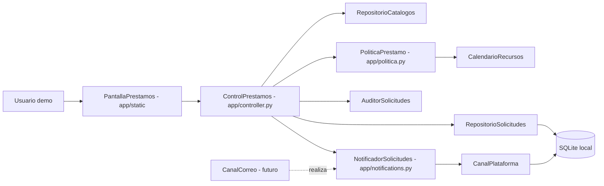

# RFC Técnico — RFC-SPEC-01: Solicitud de préstamo de equipamiento
## Prototipo del CU_01 · Laboratorio de Medios Audiovisuales (UNTDF)

| Campo | Detalle |
| :--- | :--- |
| **Título** | RFC-SPEC-01: Solicitud de préstamo de equipamiento |
| **Proyecto** | Sistema de Gestión de Servicios del Laboratorio de Medios Audiovisuales |
| **Materia / Grupo** | Ingeniería de Software I — Grupo 6 |
| **Integrantes** | Agustín Arias, Mateo Mazuela, Milagros Martínez, Luca Mechulan |
| **Fecha** | 19 de noviembre de 2026 |
| **Estado** | **BUILD Y VALIDATE COMPLETADOS (19/11/2026) — Prototipo CU_01 implementado e integrado con SQLite; 16/16 casos de prueba verificados (`29 passed` en pytest). Revisión académica UML de la cátedra pendiente.** |
| **Revisores** | Revisión interna e integración: Grupo 6. Validación académica pendiente de la cátedra; no se atribuye aprobación al docente. |
| **Fuente de verdad** | Spec 1 y CU_01 de la tercera entrega reconstruida; RF, RNF, correcciones docentes y `CONTRATOS_COMPARTIDOS.md` |

> **Alcance de este RFC:** prototipo del **CU_01 (crítico)** dentro de la Spec 1, no implementación completa de la Spec 1. La Spec 1 abarca también CU_02, CU_03 y CU_04, pero la consigna de cuarta/quinta entrega requiere prototipar el caso crítico. Se conserva la referencia a los otros casos sin fingir que están implementados. El recorte CU_01 fue confirmado por el solicitante el 17/11/2026. Este documento no supone aprobación académica del modelo UML por parte del docente.

### Registro de aprobación de decisiones y cierre de implementación (17/11/2026 – 19/11/2026)

**Estado documental: PROTOTIPO CU_01 IMPLEMENTADO Y VALIDADO POR EL GRUPO 6.** Las decisiones de alcance, reglas de demostración y stack tecnológico fueron aprobadas el 17/11/2026 y ejecutadas durante las fases Build y Validate hasta el 19/11/2026. La presentación académica de los diagramas UML v9.3 queda sujeta a la revisión de la cátedra. La política de alta gama es un supuesto controlado del prototipo, no una regla de Natalia validada empíricamente.

## 1. Alcance del prototipo y enfoque

El prototipo permite que un estudiante o docente ya identificado registre una solicitud de equipamiento de una categoría y cantidad, indicando período y materia/proyecto asociado. Valida datos, disponibilidad, restricciones y elegibilidad académica; presenta un resumen; registra la solicitud en **Pendiente/Solicitada**; conserva el evento inicial de trazabilidad y permite visualizarla en un listado. Si el solicitante es académicamente elegible pero el pedido requiere aval docente, la solicitud puede quedar pendiente de esa validación y se genera un aviso interno. **Solicitar no equivale a aprobar ni a reservar unidades concretas.** Regla aprobada únicamente para la demostración: la elegibilidad bloquea el registro si no se cumple; un estudiante elegible puede registrar la solicitud pendiente y el aval se resuelve posteriormente en CU_03. No se definieron umbrales académicos universales.

| Componente / comportamiento | Estado | Nota |
| :--- | :--- | :--- |
| Formulario web de CU_01 | **Real** | Tipo, cantidad, fechas, materia/proyecto, sugerencia +48h, botones y feedback |
| Validación de datos y período | **Real** | Fechas consistentes (`desde < hasta`), campos requeridos, cantidad positiva |
| Consulta de disponibilidad por categoría | **Real** | Unidades operativas menos ocupaciones aprobadas o activas en `[desde, hasta)`; revalidar al confirmar |
| Restricciones activas y elegibilidad académica de alta gama | **Real** | Alimentado desde SQLite con datos ficticios; la falta de elegibilidad académica bloquea la solicitud (`HTTP 403`) |
| Creación de SolicitudPrestamo pendiente | **Real** | Número autoincremental, fecha/hora, usuario y estado `PENDIENTE_SOLICITADA`; no crea `Prestamo` efectivo |
| Persistencia local / auditoría inicial | **Real** | SQLite local (`tpi_cu01.db`) con seed repetible y guardado transaccional junto a `CambioEstado` |
| Notificación dentro de la plataforma | **Real**, acotada | Registra aviso interno en tabla `notificaciones` para docente validador; envío de correo fuera del prototipo |
| Identidad de usuario / acceso | **Simulado** | Selector de sesión de demostración (`X-Usuario-Demo`) con alias ficticios precargados; **no cumple RNF-01/RNF-02 como autenticación real** |
| Aval docente posterior | **Fuera de alcance para la resolución** | CU_01 registra la necesidad de aval y notifica; CU_03 resuelve la validación |
| Prórroga, evaluación, entrega y devolución | **Fuera de alcance** | CU_02, CU_03, CU_05 y CU_06 |
| Reserva conjunta de aula y equipamiento | **Fuera de alcance** | CU_09; requiere integración posterior |
| Correo electrónico real | **Fuera de alcance** | RNF-21 admite notificación en plataforma según configuración |

### 1.1 Alternativas evaluadas

| Criterio | A. Python + FastAPI + SQLite + JS nativo | B. TypeScript + Express + SQLite + React |
| :--- | :--- | :--- |
| Cobertura CU_01 | Completa, con pocas dependencias | Completa |
| Complejidad de prototipo | Baja-media: un proyecto y HTML/JS | Media-alta: frontend y backend separados |
| Pruebas | pytest y cliente HTTP | Vitest y supertest |
| Persistencia | SQLAlchemy + SQLite | ORM/driver SQLite |
| Riesgo de plazo | Menor | Mayor por configuración y tooling |
| Evolución posterior | API HTTP reutilizable | Conveniente si el equipo ya maneja TS/React |

**Decisión ejecutada:** alternativa A (Python + FastAPI + SQLite + JavaScript nativo). Se respetaron `AGENTS.md`, `SDD_PLAYBOOK.md` y `CONTRATOS_COMPARTIDOS.md`.

## 2. Stack tecnológico verificado en Build

| Capa | Tecnología | Versión verificada | Justificación |
| :--- | :--- | :--- | :--- |
| Lenguaje y runtime | Python | `3.13.13` (win32) | Entorno virtual `.venv` instalado y verificado en Build/Validate |
| Frontend | HTML5, CSS3, JavaScript nativo | Estándares del navegador | Servido directamente por FastAPI (`StaticFiles`) sin dependencias externas |
| Backend web / API | FastAPI + Pydantic v2 | Según `requirements.txt` | Validación tipada de entrada/salida y manejo unificado de errores HTTP |
| Servidor ASGI | Uvicorn | Según `requirements.txt` | Servidor local del prototipo |
| Persistencia | SQLite + SQLAlchemy 2.x | SQLite integrada + SQLAlchemy ORM | Datos reales locales con herencia polimórfica y transacciones atómicas |
| Pruebas | pytest + httpx + TestClient | `pytest 9.2.0` (`anyio 4.16.0`) | 29 pruebas automatizadas (unitarias, API, UI e integración SQLite) |
| Editor y asistentes de IA | VS Code + Codex / Gemini | Utilizados en desarrollo guiado por RFC | Implementación incremental por módulo y auditoría de integración |
| Control de versiones | Git / GitHub (`soymat/TPI_GRUPO6_MEDIOS`) | Flujo por ramas `feat/01..04` hacia `main` | Revisión de tareas y commits trazables |

### 2.1 Requisitos del entorno

- Windows o Linux con Python 3.13, Git, VS Code y navegador actualizado.
- Sin claves de API externas para ejecutar el prototipo funcional.
- Base SQLite de desarrollo (`tpi_cu01.db`, excluida de Git en `.gitignore`) con usuarios, materias, restricciones, equipos y asignaciones ficticias.
- La base de datos de demostración se recrea de forma idempotente desde `scripts/seed_demo.py`.

## 3. Arquitectura



### 3.1 Componentes y responsabilidades

| Componente | Responsabilidad | Depende de |
| :--- | :--- | :--- |
| `PantallaPrestamos` (`app/static/`) | Mostrar selector demo, formulario, resumen, errores y confirmación; no duplicar reglas | API HTTP de `app/main.py` |
| `ControlPrestamos` (`app/controller.py`) | Coordinar CU_01, consultar catálogo, prevalidar, revalidar al confirmar, auditar y persistir sin mezclar persistencia | `PoliticaPrestamo`, `RepositorioCatalogos`, `RepositorioSolicitudes`, `AuditorSolicitudes`, `NotificadorSolicitudes` |
| `PoliticaPrestamo` (`app/politica.py`) | Validar formato, rol, disponibilidad, restricciones, alta gama y necesidad de aval; revalidar al confirmar | `CalendarioRecursos`; `Usuario`, `TipoEquipamiento` y `MateriaProyecto` como parámetros |
| `CalendarioRecursos` (`app/repository.py`) | Informar cantidad libre por tipo y período en `[desde, hasta)` descontando solo ocupaciones efectivas | `Equipamiento`, `Prestamo`, `DetallePrestamo`, `Restriccion` |
| `SolicitudPrestamo` / `Solicitud` (`app/models.py`) | Representar la petición pendiente (`PENDIENTE_SOLICITADA`) y su ciclo de estado | `Usuario`, `TipoEquipamiento`, `MateriaProyecto`, `CambioEstado` |
| `RepositorioSolicitudes` (`app/repository.py`) | Guardar `SolicitudPrestamo` + `CambioEstado` en una transacción y listar solicitudes del usuario | SQLAlchemy `Session` / SQLite |
| `NotificadorSolicitudes` y `CanalPlataforma` (`app/notifications.py`) | Consultar destinatario docente, crear aviso interno y persistirlo en `notificaciones` | SQLAlchemy `Session` / SQLite |

### 3.2 Alineación con modelo de clases del TPI

| Clase del TPI | En la implementación técnica | Modificación / adaptación documentada |
| :--- | :--- | :--- |
| `Usuario`, `Estudiante`, `Docente`, `PersonalLaboratorio` | `app/models.py` (herencia SQLAlchemy) | `Estudiante` incorpora `elegible_alta_gama`; `Docente` incorpora `es_tutor`; `Usuario` expone `@property rol` |
| `Docente`, `AsignacionDocenteMateria` y `MateriaProyecto` | `app/models.py` | En el recorte CU_01, `MateriaProyecto` incluye `habilita_alta_gama` y el docente validador se consulta desde `Docente` |
| `Solicitud`, `SolicitudPrestamo` | `app/models.py` | Estado `PENDIENTE_SOLICITADA`; instanciada vía fábrica inyectada en `ControlPrestamos` y auditada por `AuditorSolicitudes` |
| `Equipamiento`, `CalendarioRecursos` | `app/models.py`, `app/repository.py` | `TipoEquipamiento` indica `alta_gama`; `CalendarioRecursos` calcula disponibilidad sin listar préstamos de usuarios |
| `Restriccion`, `MateriaProyecto`, `Notificacion`, `CambioEstado` | `app/models.py` | `CambioEstado` se vincula a `Solicitud` y se guarda en la misma transacción |
| `PantallaPrestamos`, `ControlPrestamos` | `app/static/`, `app/controller.py` | Frontera y controlador desacoplados mediante API JSON |
| `PoliticaPrestamo`, `NotificadorSolicitudes` | `app/politica.py`, `app/notifications.py` | GRASP Fabricación pura, Indirección, Bajo acoplamiento |
| `RepositorioCatalogos`, `RepositorioSolicitudes` | `app/repository.py` | Indirección y Variaciones Protegidas: `ControlPrestamos` recibe colaboradores inyectados |
| `DetallePrestamo` y `Prestamo` | `app/models.py` | Representan ocupación efectiva para el cálculo de disponibilidad; no se instancian durante CU_01 |

El **diagrama único de clases de diseño v9.3** se muestra una sola vez (Figura 2 de la sección 11.1 del TPI). Incorpora además `PantallaProrrogas`, `ControlProrrogas`, `PantallaRegistro` y `ControlRegistro`, porque aparecen en los diagramas dinámicos acumulados. El CU_01 usa las firmas declaradas en `ControlPrestamos`, `PoliticaPrestamo`, `RepositorioSolicitudes` y `NotificadorSolicitudes`. La matriz CSV adjunta vincula cada mensaje con su firma y relación. El RFC mantiene su alcance de prototipo únicamente para CU_01.

**Ajuste GRASP v9 — responsabilidades, polimorfismo y relaciones M:N:** las entidades de datos (`Estudiante`, `Prestamo`, `TipoEquipamiento`, `Solicitud` y `Restriccion`) exponen atributos mediante constructores y propiedades; la evaluación de reglas se encuentra en `PoliticaPrestamo`. `AuditorSolicitudes.registrar_alta(solicitud, usuario)` construye `CambioEstado` y la solicitud lo agrega a su historial. `CanalPlataforma.enviar(...)` implementa el envío interno persistiendo `Notificacion`, mientras `CanalCorreo` queda fuera de alcance para el prototipo.

## 4. Diseño detallado

### 4.1 Flujo principal (CU_01)

1. Usuario de demostración selecciona su alias en `X-Usuario-Demo`, inicia CU_01 y se presenta el formulario con controles concretos.
2. Ingresa tipo, cantidad, fecha desde/hasta (con sugerencia opcional `+48h`) y materia/proyecto; pulsa **Continuar**.
3. `ControlPrestamos` obtiene `TipoEquipamiento` y `MateriaProyecto` de `RepositorioCatalogos` mediante sus identificadores y los pasa, junto con el usuario y los datos, a `PoliticaPrestamo.evaluar`. Se validan formato, disponibilidad, restricciones y elegibilidad académica/necesidad de aval.
4. Si todas son satisfactorias, la interfaz muestra resumen y botones **Confirmar, Volver y Cancelar**.
5. Al confirmar, se deshabilita el botón durante el envío, se vuelven a consultar los catálogos y se ejecuta `PoliticaPrestamo.revalidar` antes de cualquier guardado; un cambio desfavorable no produce una solicitud (`HTTP 409`).
6. `ControlPrestamos` crea una `SolicitudPrestamo` e invoca `AuditorSolicitudes.registrar_alta(solicitud, usuario)`. Esa operación genera `CambioEstado` con fecha/hora y actor, y `RepositorioSolicitudes.guardar_con_historial` persiste ambos en una transacción.
7. Si el solicitante es elegible y requiere aval docente (`requiere_aval=True`), `NotificadorSolicitudes.avisar_aval(solicitud, materia)` crea el aviso interno y lo persiste mediante `CanalPlataforma` en `notificaciones`, para posterior validación en CU_03. No se envía correo real.
8. El sistema muestra número y estado `PENDIENTE_SOLICITADA`; el usuario entra a **Mis solicitudes** y visualiza la nueva petición.

**Invariante central:** una solicitud pendiente **no reserva ni presta automáticamente** una unidad de equipamiento. La aprobación y asignación concreta pertenecen a CU_03.

### 4.2 Estados y transiciones

Ver `Fuentes/diagramas/Estados_SolicitudPrestamo_v9_3.svg`. El estado pertenece a `Solicitud`, y es heredado por `SolicitudPrestamo`.

| Estado inicial | Evento / CU | Estado siguiente | Efecto |
| :--- | :--- | :--- | :--- |
| Inicial | CU_01: Confirmar solicitud válida | `PENDIENTE_SOLICITADA` | Guardar petición y `CambioEstado` inicial |
| `PENDIENTE_SOLICITADA` | CU_03: Aprobar | `APROBADA_CONFIRMADA` | Reserva efectiva (fuera de este prototipo) |
| `PENDIENTE_SOLICITADA` | CU_03: Rechazar o CU_15: Cancelar | `CANCELADA_RECHAZADA` | Registrar motivo (fuera de este prototipo) |
| `APROBADA_CONFIRMADA` | CU_05: Entrega | `EN_CURSO_RETIRADO` | Registrar salida de unidades (fuera de este prototipo) |
| `APROBADA_CONFIRMADA` | CU_15: Cancelación autorizada | `CANCELADA_RECHAZADA` | Liberar asignaciones (fuera de este prototipo) |
| `EN_CURSO_RETIRADO` | CU_06: Devolución | `FINALIZADA_DEVUELTA` | Registrar recepción e incidencias (fuera de este prototipo) |

### 4.3 Escenarios alternativos y manejo de errores

| Extensión CU_01 | Condición | Respuesta verificada |
| :--- | :--- | :--- |
| 4a | Datos incompletos o inválidos (`cantidad <= 0`, `hasta <= desde`, catálogo inexistente) | `HTTP 422` con errores por campo; mantiene valores válidos |
| 4b | Categoría/cantidad indisponible para el período | `HTTP 409` (`SIN_DISPONIBILIDAD`); 0 solicitudes creadas |
| 4c | Restricción activa sobre recurso/usuario | `HTTP 403` (`RESTRICCION_ACTIVA`) mostrando motivo; 0 solicitudes creadas |
| 4d | Alta gama sin elegibilidad académica | `HTTP 403` (`NO_ELEGIBLE`); 0 solicitudes creadas |
| 4e | Solicitante académicamente elegible + alta gama | `HTTP 201` en `PENDIENTE_SOLICITADA` con `requiere_aval=True` y aviso interno generado |
| 5a | Usuario elige **Volver** | Restaura formulario conservando datos ingresados |
| 5b | Usuario elige **Cancelar** | Reinicia flujo sin registrar solicitud |
| Validación al confirmar | Cambia disponibilidad entre resumen y confirmación | `HTTP 409` (`DISPONIBILIDAD_CAMBIO`); no guarda solicitud y vuelve al formulario |
| Error de persistencia | Falla SQLite / restricción de integridad | `HTTP 500` (`ERROR_PERSISTENCIA`); rollback transaccional sin falso éxito |

### 4.4 Interfaz de usuario

Vista 1: selección de categoría, cantidad, fechas (con botón `+48h`) y materia/proyecto, con botones **Continuar** y **Cancelar**. Vista 2: resumen con **Confirmar**, **Volver** y **Cancelar**. Vista 3: número y estado **PENDIENTE_SOLICITADA**, con acción **Mis solicitudes**. Vista 4: listado personal filtrado por `X-Usuario-Demo`. En caso de validación negativa, marca campos o recursos y ofrece una acción clara sin mostrar falsa confirmación.

## 5. Modelo de datos (persistencia local real en SQLite)

| Entidad / tabla SQLite (`app/models.py`) | Datos principales | Restricción / relación |
| :--- | :--- | :--- |
| `usuarios` | `id` (UUID), `nombre_completo`, `dni`, `correo`, `alias`, `tipo_usuario` | `dni`, `correo` y `alias` únicos; discriminador polimórfico |
| `estudiantes` | `id` (FK `usuarios.id`), `elegible_alta_gama` | Subtipo de `usuarios` |
| `docentes` | `id` (FK `usuarios.id`), `es_tutor` | Subtipo de `usuarios` |
| `materias_proyecto` | `id` (UUID), `nombre`, `prioridad`, `habilita_alta_gama` | Catálogo de materias/proyectos de demo |
| `tipos_equipamiento` | `codigo` (PK), `nombre`, `alta_gama` | Catálogo de tipos; `@property id` expone `codigo` |
| `equipamientos` | `id`, `numero_inventario` (UNIQUE), `tipo_codigo`, `estado` | Inventario único; estados `OPERATIVO`, `MANTENIMIENTO`, etc. |
| `restricciones` | `id`, `estudiante_id`, `tipo_codigo` (nullable), `motivo`, `desde`, `hasta`, `activa` | Validar vigencia temporal y alcance por tipo o general |
| `prestamos` / `detalles_prestamo` | `id`, `solicitud_numero`, `desde`, `hasta` / `prestamo_id`, `equipamiento_id` | Reflejan préstamos efectivos, no solicitudes pendientes |
| `solicitudes` | `numero` (PK autoincrement), `usuario_id`, `creada_en`, `estado`, `tipo_solicitud` | Estado inicial `PENDIENTE_SOLICITADA` |
| `solicitudes_prestamo` | `numero` (FK `solicitudes.numero`), `tipo_codigo`, `cantidad`, `desde`, `hasta`, `materia_id`, `requiere_aval` | Subtipo 1:1 con `solicitudes` |
| `cambios_estado` | `id`, `solicitud_numero`, `actor_id`, `anterior`, `nuevo`, `fecha_hora` | Evento de creación persistido en la misma transacción |
| `notificaciones` | `id`, `destinatario_id`, `solicitud_numero`, `mensaje`, `fecha_creacion` | Persistidas mediante `CanalPlataforma` |

**Consistencia temporal:** el solapamiento de períodos se evalúa por `inicio_a < fin_b and inicio_b < fin_a` para intervalos semiabiertos `[desde, hasta)`. No se asignan unidades particulares durante CU_01.

## 6. Interfaces (API HTTP implementada)

| Método | Ruta / operación | Entrada | Salida / estado | Error |
| :--- | :--- | :--- | :--- | :--- |
| `GET` | `/api/equipos/tipos` | — | `list[TipoEquipamientoSalida]` (`200`) | `500`, `503` |
| `GET` | `/api/materias` | — | `list[MateriaSalida]` (`200`) | `500`, `503` |
| `POST` | `/api/solicitudes/prevalidar` | `DatosSolicitud` + header `X-Usuario-Demo` | `ResultadoValidacionSalida` (`200`) | `403`, `409`, `422`, `503` |
| `POST` | `/api/solicitudes` | `DatosSolicitud` + header `X-Usuario-Demo` | `SolicitudCreadaSalida` (`201`) | `403`, `409`, `422`, `500`, `503` |
| `GET` | `/api/solicitudes/mias` | Header `X-Usuario-Demo` | `list[SolicitudListadoSalida]` (`200`) | `403`, `500`, `503` |

La identificación no proviene de un `usuario_id` libre en el formulario: el backend la resuelve a partir del header `X-Usuario-Demo` contra usuarios ficticios precargados.

## 7. Estructura real del código implementado

```text
TPI_GRUPO6_MEDIOS/
├── AGENTS.md
├── SDD_PLAYBOOK.md
├── RFC_TEMPLATE.md
├── requirements.txt
├── app/
│   ├── __init__.py
│   ├── main.py                 # FastAPI, handlers de error, endpoints y ensamblaje SQLite
│   ├── models.py               # Entidades ORM SQLAlchemy y relaciones
│   ├── schemas.py              # DTOs Pydantic de entrada/salida y utilidades
│   ├── controller.py           # ControlPrestamos (orquestación CU_01)
│   ├── politica.py             # PoliticaPrestamo (evaluar, revalidar y disponibilidad)
│   ├── repository.py           # RepositorioCatalogos, CalendarioRecursos, AuditorSolicitudes, RepositorioSolicitudes
│   ├── notifications.py        # NotificadorSolicitudes y CanalPlataforma
│   └── static/                 # HTML, CSS y JS nativos (index.html, styles.css, app.js)
├── scripts/
│   ├── __init__.py
│   └── seed_demo.py            # Carga idempotente de usuarios, equipos, materias y restricciones demo
├── tests/
│   ├── test_api.py             # Pruebas de endpoints y ControlPrestamos con dobles (11 tests)
│   ├── test_interfaz.py        # Pruebas de interfaz estática y flujos UI end-to-end (6 tests)
│   ├── test_solicitudes.py     # Pruebas de integración real contra SQLite (4 tests)
│   └── test_validacion.py      # Pruebas unitarias de PoliticaPrestamo y disponibilidad (8 tests)
└── documentacion/
    └── TPI_GRUPO6_ETAPA4/
```

### 7.1 Ejecución verificada (Build & Validate)

```powershell
python -m venv .venv
.\.venv\Scripts\Activate.ps1
python -m pip install -r requirements.txt pytest httpx
python -m pytest -v
# Salida obtenida: 29 passed, 1 warning in 1.46s
uvicorn app.main:app --reload
```

## 8. Plan de verificación y resultados obtenidos (Validate)

| ID | Requisito / criterio | Procedimiento | Resultado esperado | Obtenido |
| :--- | :--- | :--- | :--- | :--- |
| TC-01 | RF-03 / CU_01 principal | Completar datos válidos, continuar y confirmar | HTTP 201, número único y estado `PENDIENTE_SOLICITADA` | **PASS** — `test_api.py::test_confirmar_revalida_audita_y_guarda_tc01_tc08_tc09` y `test_interfaz.py::test_recorrido_principal_y_mis_solicitudes_tc01_tc15` devuelven `201` con número único y estado `PENDIENTE_SOLICITADA`. |
| TC-02 | CU_01 4a | Dejar cantidad `<= 0` o fecha `hasta <= desde` | Errores por campo; 0 solicitudes nuevas | **PASS** — `test_validacion.py::test_tc02_cantidad_no_positiva_y_rango_fechas_invalido` y `test_api.py::test_datos_invalidos_devuelven_errores_por_campo_tc02` devuelven `422` con `campo="cantidad"` / `campo="hasta"`. |
| TC-03 | RF-03 / RNF-06 / CU_01 4b | Pedir 2 unidades cuando solo 1 está libre | Mensaje indisponibilidad; 0 solicitudes nuevas | **PASS** — `test_validacion.py::test_tc03_y_tc06_disponibilidad_excluye_no_operativos_y_pendientes` y `test_solicitudes.py::test_tc03_tc06_solicitud_pendiente_no_ocupa_pero_prestamo_efectivo_si` devuelven `409` (`SIN_DISPONIBILIDAD`). |
| TC-04 | RNF-12 / CU_01 4c | Usuario con restricción activa para el tipo | Bloqueo con motivo; 0 solicitudes | **PASS** — `test_validacion.py::test_tc04_restriccion_activa_bloquea_solicitud` y `test_interfaz.py::test_errores_validacion_restriccion_y_alta_gama_tc02_tc04_tc05` devuelven `403` (`RESTRICCION_ACTIVA`) con el motivo. |
| TC-05 | RNF-11 / CU_01 4d | Usuario que no cumple condición académica solicita alta gama | Error de elegibilidad académica; 0 solicitudes nuevas | **PASS** — `test_validacion.py::test_tc05_y_tc10_alta_gama_elegibilidad_y_aval` y `test_interfaz.py::test_errores_validacion_restriccion_y_alta_gama_tc02_tc04_tc05` devuelven `403` (`NO_ELEGIBLE`). |
| TC-06 | RNF-13 y RNF-18 | Inventario con unidades en mantenimiento y solicitudes pendientes | No cuentan como disponibles los no operativos; pendientes no descuentan cupo | **PASS** — `test_validacion.py::test_tc03_y_tc06_disponibilidad_excluye_no_operativos_y_pendientes` y `test_solicitudes.py::test_tc03_tc06_solicitud_pendiente_no_ocupa_pero_prestamo_efectivo_si` verifican exclusión de `MANTENIMIENTO` y no descuento por `PENDIENTE_SOLICITADA`. |
| TC-07 | RNF-05 | Cargar dos equipos con el mismo inventario en SQLite | Restricción de unicidad activada | **PASS** — `test_solicitudes.py::test_tc07_inventario_unico_impide_duplicados` dispara `sqlalchemy.exc.IntegrityError` al duplicar `INV-CAM-01`. |
| TC-08 | RNF-17 | Confirmar solicitud válida | Se registra exclusivamente `PENDIENTE_SOLICITADA` | **PASS** — `test_solicitudes.py::test_tc08_tc09_guardado_atomico_solicitud_e_historial_en_sqlite` verifica persistencia en `solicitudes` con `estado="PENDIENTE_SOLICITADA"` y 0 filas en `prestamos`. |
| TC-09 | RNF-19 | Confirmar solicitud válida | Evento inicial con fecha/hora, actor y estado nuevo | **PASS** — `test_solicitudes.py::test_tc08_tc09_guardado_atomico_solicitud_e_historial_en_sqlite` verifica `CambioEstado` con `anterior=None`, `nuevo="PENDIENTE_SOLICITADA"` y `actor_id` en la misma transacción. |
| TC-10 | RF-31 / RF-29 / RNF-11 / RNF-21 / CU_01 4e | Usuario académicamente elegible confirma alta gama que requiere aval docente | Solicitud creada en `PENDIENTE_SOLICITADA` (`requiere_aval=True`) + aviso interno; 0 unidades reservadas | **PASS** — `test_solicitudes.py::test_tc10_tc15_alta_gama_genera_notificacion_real_y_filtra_mis_solicitudes` y `test_api.py::test_confirmar_con_aval_genera_aviso_interno_tc10` crean fila en `notificaciones` para `docente-demo`. |
| TC-11 | CU_01 5a/5b | Volver y cancelar | Datos conservados al volver; cancelar no registra | **PASS** — `test_interfaz.py::test_archivos_estaticos_y_controles_ui_tc11_tc14_tc16` verifica `btn-volver` (conserva formulario) y `btn-cancelar-resumen` (reinicia sin `POST`). |
| TC-12 | Concurrencia / CU_01 4b | Ocupar recurso entre prevalidación y confirmación | Revalidación rechaza con `409`; sin guardado inválido | **PASS** — `test_api.py::test_cambio_de_disponibilidad_impide_guardar_tc12`, `test_validacion.py::test_tc12_revalidar_detecta_cambio_de_disponibilidad_al_confirmar` y `test_interfaz.py::test_revalidacion_fallida_al_confirmar_devuelve_409_tc12` devuelven `409` (`DISPONIBILIDAD_CAMBIO`). |
| TC-13 | RNF-02 (parcial por sesión demo) | Probar usuarios demo de rol Estudiante, Docente y PersonalLaboratorio | Estudiante y Docente acceden; otros roles rechazados con `403` | **PASS** — `test_api.py::test_solo_estudiante_o_docente_pueden_solicitar_tc13`, `test_validacion.py::test_tc13_docente_no_recibe_reglas_exclusivas_de_estudiante` y `test_interfaz.py::test_roles_demo_permitidos_y_denegados_tc13` verifican acceso y bloqueo `403`. |
| TC-14 | RNF-03 (criterio estándar 48h) | Usar fecha inicial y completar vencimiento estándar | Sugerencia de `+48h`, sin afirmar límite máximo no relevado | **PASS** — `test_validacion.py::test_tc14_sugerencia_estandar_48_horas` y `test_interfaz.py::test_archivos_estaticos_y_controles_ui_tc11_tc14_tc16` verifican cálculo exacto de `+48h` y botón `btn-sugerir-48h`. |
| TC-15 | Trazabilidad CU_01 | Confirmar y abrir Mis solicitudes | Misma solicitud visible con número y estado solo para su autor | **PASS** — `test_solicitudes.py::test_tc10_tc15_alta_gama_genera_notificacion_real_y_filtra_mis_solicitudes` y `test_interfaz.py::test_recorrido_principal_y_mis_solicitudes_tc01_tc15` confirman filtrado por `X-Usuario-Demo`. |
| TC-16 | RNF-01 (límite declarado) | Revisar documentación, UI y datos de seed | No hay DNI/correo real; RNF-01 producción marcada como no cubierta | **PASS** — `test_interfaz.py::test_archivos_estaticos_y_controles_ui_tc11_tc14_tc16` verifica leyenda *"No constituye autenticación productiva"*; `seed_demo.py` usa correos `@demo.untdf.edu.ar` y `.gitignore` excluye `*.db`. |

**Criterios sin implementación en este recorte:** RNF-04 (aprobación de prórroga), RNF-09/10 (prioridad de aprobación), CU_02/03/04, correo electrónico real y autenticación productiva.

### 8.1 Métricas verificadas

- **Cobertura de pruebas:** **16/16 TC (`100 %`)** dentro del alcance ejecutados y documentados (`29 passed in 1.46s`).
- **Prevención de doble envío:** el botón **Confirmar** (`btnConfirmar`) se deshabilita inmediatamente al iniciar el `POST /api/solicitudes` en `app/static/app.js` hasta recibir respuesta del servidor (verificado en `test_interfaz.py::test_archivos_estaticos_y_controles_ui_tc11_tc14_tc16`), sin implementar `Idempotency-Key` conforme a `04_FRONTEND_VALIDACION.md`.
- **Tiempo de ejecución:** la suite completa de 29 pruebas (incluyendo bases SQLite temporales) finaliza en **1.46 segundos**.

## 9. Riesgos, preguntas abiertas y decisiones cerradas para la demo

| ID | Decisión / riesgo | Impacto | Resolución aplicada en el prototipo |
| :--- | :--- | :--- | :--- |
| D-01 | Herramienta de IA para Build | Alto | **APLICADA:** Codex y Gemini utilizados siguiendo `AGENTS.md` y `SDD_PLAYBOOK.md`. |
| D-02 | Alcance exacto de la demo | Alto | **APLICADA:** Exclusivamente CU_01; CU_02/03/04 documentados, pero fuera de Build. |
| D-03 | Elegibilidad y aval para equipamiento de alta gama | Alto | **APLICADA:** `TipoEquipamiento.alta_gama` + `Estudiante.elegible_alta_gama` / `MateriaProyecto.habilita_alta_gama` en seed demo. Bloquea si no es elegible (`403`); habilita con `requiere_aval=True` si es elegible. |
| D-04 | Duración estándar del préstamo | Alto | **APLICADA:** Sugerencia automática y botón `+48h` desde fecha de inicio (RNF-03), sin máximo global impuesto. |
| D-05 | Anticipación respecto de la fecha solicitada | Medio | **APLICADA:** Períodos futuros válidos (`desde < hasta`) sin máximo de anticipación adicional. |
| D-06 | Identidad y autenticación del prototipo | Alto | **APLICADA:** Header `X-Usuario-Demo` con aliases precargados (`estudiante-comun`, `estudiante-elegible`, `estudiante-restringido`, `docente-demo`, `personal-demo`). |
| D-07 | Destinatarios de avisos de aval | Medio | **APLICADA:** `NotificadorSolicitudes` persiste aviso interno en `notificaciones` dirigido al docente validador precargado (`docente-demo`). |
| D-08 | Solicitudes pendientes superpuestas | Alto | **APLICADA:** `CalendarioRecursos` solo descuenta `Prestamo` + `DetallePrestamo` efectivos; solicitudes en `PENDIENTE_SOLICITADA` no bloquean unidades. |
| D-09 | Procesamiento independiente del CU_01 | Medio | **APLICADA:** `PoliticaPrestamo` evalúa restricciones, elegibilidad/aval y disponibilidad de forma independiente y revalida antes de confirmar. |
| D-10 | Protección de datos de la demostración | Alto | **APLICADA:** Dataset enteramente ficticio en `scripts/seed_demo.py` y exclusión de `*.db` en `.gitignore`. |

### 9.1 Reglas reproducibles para el conjunto de datos ficticio

- **Alta gama:** el tipo de equipamiento declara `alta_gama` en `TipoEquipamiento`. El seed (`scripts/seed_demo.py`) marca estudiantes con `elegible_alta_gama=True` (`estudiante-elegible`) o materias con `habilita_alta_gama=True` (`Proyecto 4 - Tesis Audiovisual`); **no** se infiere por un año arbitrario.
- **Estudiante común + alta gama:** el sistema informa falta de elegibilidad (`HTTP 403 NO_ELEGIBLE`) y no registra solicitud.
- **Estudiante elegible + alta gama:** se registra solicitud `PENDIENTE_SOLICITADA`, se señala `requiere_aval=True` y se generan avisos de plataforma; no hay reserva ni préstamo efectivo.
- **Docentes:** CU_01 admite `Docente` (`docente-demo`) además de `Estudiante`, validado por separado en **TC-13**: registra solicitud válida en `PENDIENTE_SOLICITADA` sin aplicar reglas académicas exclusivas de `Estudiante`.
- **Disponibilidad:** las solicitudes pendientes no asignan unidades concretas; se considera ocupación efectiva y condición operativa, revalidando al confirmar.
- **Identidad:** alias seleccionado en la interfaz de demostración (`X-Usuario-Demo`); nunca se presenta como login real.
- **Error al persistir avisos:** se mantiene la solicitud guardada y se devuelve una advertencia registrable (`advertencias`) para reintento de notificación; no se muestra un falso éxito de envío.

## 10. Plan de trabajo ejecutado (Build & Validate)

| Tarea | Responsable | Evidencia / TC | Estado |
| :--- | :--- | :--- | :--- |
| B-00 — registrar decisiones, RFC y revisión UML | Solicitante y resto del grupo | Decisiones RFC aprobadas; saneamiento UML v9.3 realizado | **COMPLETADO** |
| B-01 — preparar proyecto, dependencias y datos demo | Integrante 3 + Integración | `requirements.txt`, `scripts/seed_demo.py`, `TC-07` | **COMPLETADO** |
| B-02 — modelar entidades y estados con pruebas | Integrante 3 + Integración | `app/models.py`, `tests/test_solicitudes.py` (`TC-08`, `TC-09`) | **COMPLETADO** |
| B-03 — política de validación de formato, restricciones, elegibilidad y aval | Integrante 2 | `app/politica.py`, `tests/test_validacion.py` (`TC-02, 04, 05, 06, 10, 14`) | **COMPLETADO** |
| B-04 — disponibilidad real por período | Integrante 2 + Integración | `PoliticaPrestamo.calcular_disponibles`, `CalendarioRecursos` (`TC-03`, `TC-12`) | **COMPLETADO** |
| B-05 — controlador, API y persistencia transaccional | Integrante 1 + Integración | `app/main.py`, `app/controller.py`, `app/schemas.py`, `app/repository.py`, `tests/test_api.py` (`TC-01, 08, 09, 12, 13`) | **COMPLETADO** |
| B-06 — notificación interna cuando aplique | Integrante 3 + Integración | `app/notifications.py` (`NotificadorSolicitudes`, `CanalPlataforma`), `TC-10` | **COMPLETADO** |
| B-07 — pantalla y recorridos alternativos | Integrante 4 | `app/static/` (`index.html`, `styles.css`, `app.js`), `tests/test_interfaz.py` (`TC-01, 11, 14, 15, 16`) | **COMPLETADO** |
| B-08 — probar integración SQLite, RNF y demo | Grupo 6 | `tests/test_solicitudes.py` + `pytest -v` (`29 passed`) | **COMPLETADO** |

### 10.1 Registro resumido de asistencia de IA (SDD Playbook §4.4 / §6)

| Frente / Tarea | Herramienta utilizada | Alcance generado y verificación humana aplicada |
| :--- | :--- | :--- |
| Planificación y RFC (`B-00`) | Codex / Gemini | Redacción estructurada del RFC y contratos compartidos (`Equipo/*.md`), contrastados manualmente contra UML v9.3. |
| API y Controlador (`B-05`) | Codex en VS Code | Implementación de `main.py`, `controller.py`, `schemas.py` y `test_api.py`; revisión de códigos HTTP (`403`, `409`, `422`, `500`). |
| Política y Disponibilidad (`B-03`, `B-04`) | Codex en VS Code | Implementación de `politica.py` y `test_validacion.py`; validación manual de intervalos semiabiertos `[desde, hasta)` y regla de docentes (`TC-13`). |
| Frontend y Demo (`B-07`) | Codex en VS Code | Implementación de `app/static/` y `test_interfaz.py`; verificación de bloqueo de doble clic sin `Idempotency-Key`. |
| Persistencia, Seed e Integración (`B-01`, `B-02`, `B-06`, `B-08`) | Gemini / Codex | Adaptación de `models.py`, `repository.py`, `notifications.py`, `scripts/seed_demo.py`, ensamblaje de `crear_app_integrada` y ejecución de `test_solicitudes.py` (`29 passed`). |

## 11. Historial de cambios

| Versión | Fecha | Autor | Modificación |
| :--- | :--- | :--- | :--- |
| 0.1 | 13/11/2026 | Borrador asistido por IA, sujeto a revisión del grupo | Plan inicial CU_01 con trazabilidad, alternativas y pruebas |
| 0.2 | 13/11/2026 | Revisión de coherencia UML del grupo | Matriz de mensajes, modelo único y actividad con merge y revalidación |
| 0.3 | 16/11/2026 | Revisión documental y del modelo UML | Sincronización Word/Markdown del catálogo de tipos; relación Docente–MateriaProyecto |
| 0.4 | 16/11/2026 | Revisión GRASP del modelo de diseño | Clases de dominio centradas en datos; asociación académica interpuesta; Creador/Polimorfismo |
| 0.5 | 16/11/2026 | Revisión de coherencia UML | Arquitectura de avisos sincronizada, constructor en ControlPrestamos y relaciones M:N interpuestas |
| 0.6 | 17/11/2026 | Decisiones expresas del solicitante | Se aprueba el RFC para el prototipo CU_01: Codex, demo con usuarios ficticios, reglas de alta gama y aval posterior |
| 0.7 | 17/11/2026 | Revisión final de Plan / solicitante | RFC aprobado para Build de CU_01; D-01…D-10 cerradas para demo |
| 1.0 | 19/11/2026 | Grupo 6 (cierre Build & Validate) | Integración real SQLite (`crear_app_integrada`, `scripts/seed_demo.py`), suite completa `tests/test_solicitudes.py` y ejecución verificada de `TC-01`..`TC-16` (`29 passed in 1.46s`). |

## Checklist de decisión y control de Gate 1 / Validate

- [x] Herramienta de IA y alcance exclusivo CU_01 confirmados con base en las aclaraciones del profesor.
- [x] D-01 a D-10 resueltas para la demostración y aplicadas en el código; los supuestos no son reglas productivas del laboratorio.
- [x] Los criterios de aceptación del recorte CU_01 se cruzan con la Spec y los RF/RNF aplicables; CU_02/03/04 quedan explícitamente fuera del Build.
- [x] El grupo revisa y aprueba los diagramas UML saneados en v9.3; validación académica del profesor pendiente.
- [x] Se verifican las versiones, dependencias y ejecución real mediante instalación en `.venv` (`pytest -v` -> `29 passed`).
- [x] Revisión cruzada entre integrantes del Grupo 6 mediante Pull Requests e integración en `main`.
- [x] Todos los casos de prueba (`TC-01` a `TC-16`) ejecutados y documentados con evidencia verificable.

**Fuentes:** TPI Grupo 6 — tercera entrega reconstruida (CU_01, Spec 1, RF/RNF); Observaciones del profesor sobre tercera entrega; *Patrones.pdf*; *TPI - Cuarta Entrega*; *RFC_TEMPLATE.md*, *AGENTS.md* y *SDD_PLAYBOOK.md*.

## Anexo técnico — Contratos y correspondencia UML (revisión de diseño)

El contrato reproducible se encuentra en `Contrato_UML_v9_3.json`; la trazabilidad de los mensajes en `Matriz_Contratos_UML_v9_3.csv` y las relaciones en `Relaciones_DCD_v9_3.csv`. La única lámina de DCD está en la Figura 2 del TPI. No se utilizan asociaciones permanentes para objetos que solamente son parámetros o variables locales.

- `CalendarioRecursos` comprueba disponibilidad o conflictos en `[desde, hasta)`, sin listar préstamos por usuario.
- `ResolutorUsuarioDemo` resuelve aliases ficticios precargados y `NotificadorSolicitudes` localiza el docente destinatario para avisos de aval.
- `RepositorioCatalogos` recupera `TipoEquipamiento` y `MateriaProyecto`; `PoliticaPrestamo` recibe ambos objetos y no inventa datos de dominio.
- `AuditorSolicitudes.registrar_alta(solicitud, usuario)` construye un `CambioEstado`; la solicitud lo incorpora y `RepositorioSolicitudes.guardar_con_historial` guarda ambos atómicamente en SQLite.
- `NotificadorSolicitudes` delega en `CanalPlataforma` para persistir avisos en `notificaciones`, sin depender de correo externo. `CanalCorreo` queda sin implementar.

**Decisiones aplicadas en Build & Validate (19/11/2026):** solo CU_01; identidad simulada por `X-Usuario-Demo`; elegibilidad representada mediante datos ficticios; aval posterior; 48 h estándar; solicitudes pendientes no reservan unidades; avisos internos; validaciones independientes y revalidación al confirmar.

### Nota de sincronización del modelo UML — v9.3 (17/11/2026 – 19/11/2026)

El **único DCD de diseño**, usado como fuente para las interacciones, se actualizó a `Contrato_UML_v9_3.json` y sus matrices. Se corrigieron la notación y los caminos alternativos de CU_01, CU_02 y CU_07; se conservó la arquitectura GRASP y el alcance del prototipo. En el **modelo completo (fuera de CU_01)**, `Notificacion` tiene un único origen opcional entre `Solicitud`, `Prestamo` (incluida devolución), `ReservaAula` o `EventoEmergencia`; se añadieron afectaciones de retiro programado y tutoría a CU_19. La convención de visibilidad para objetos retornados se registra como variable local.

La secuencia CU_01 se modela como **escenario Estudiante**, con alternativas excluyentes. La realización de **Docente** no está dibujada allí: se prueba por separado en **TC-13**, con usuario ficticio de ese rol, formulario válido y registro `PENDIENTE_SOLICITADA`, sin consultar año de cursada ni elegibilidad exclusiva de `Estudiante`. En comunicación CU_01 se detalla únicamente el subescenario común, válido y sin aval.

**Estado final:** la implementación del prototipo CU_01 y los 16 casos de prueba (`29 passed` en `pytest`) se encuentran ejecutados y verificados en este repositorio; la presentación de los diagramas UML v9.3 permanece sujeta a revisión académica de la cátedra.